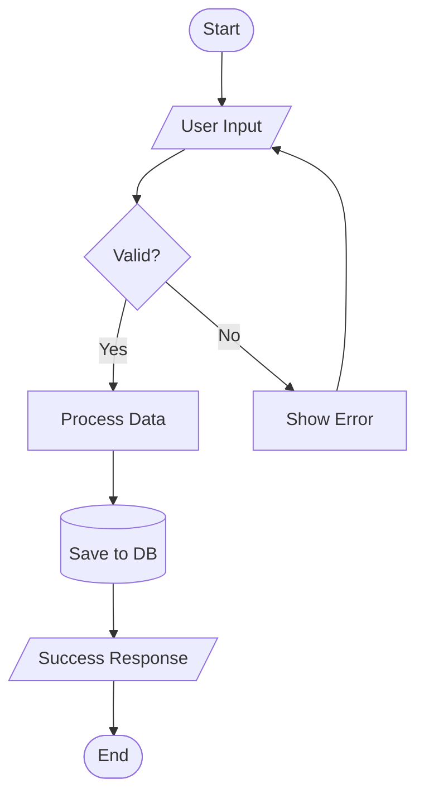
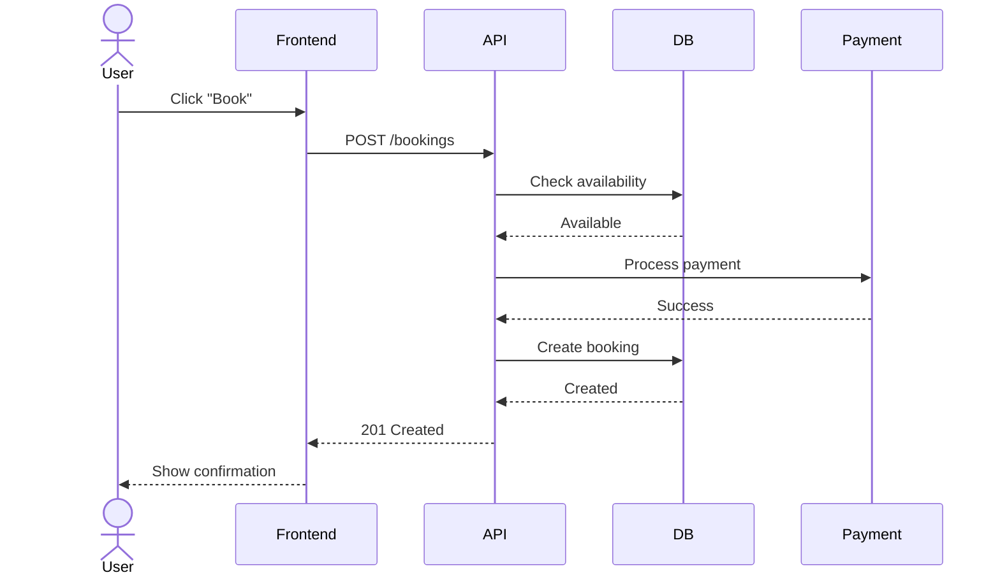
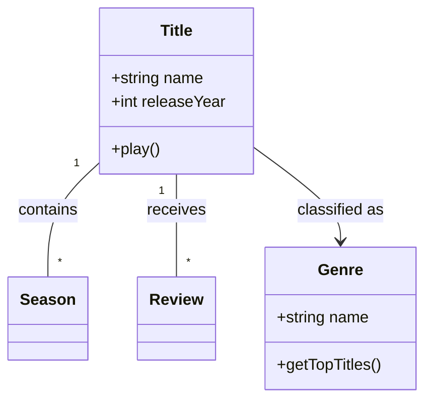
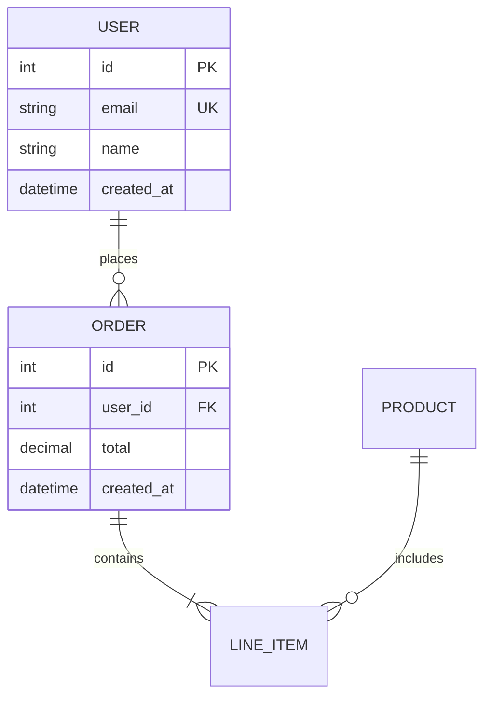
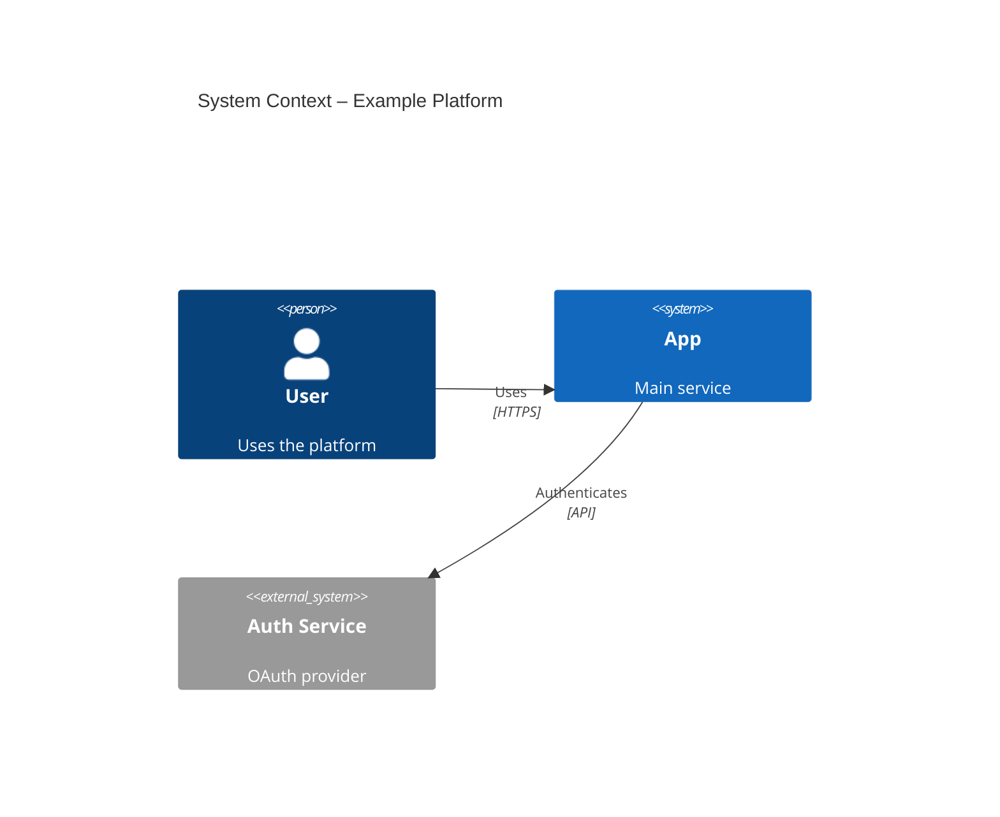
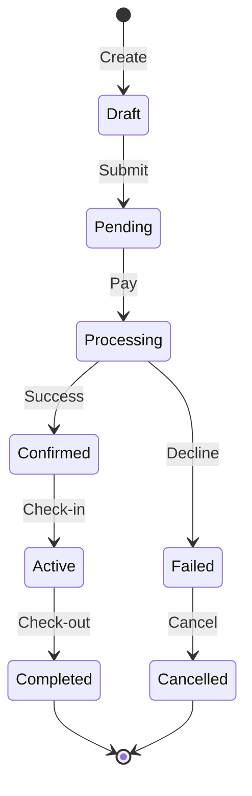
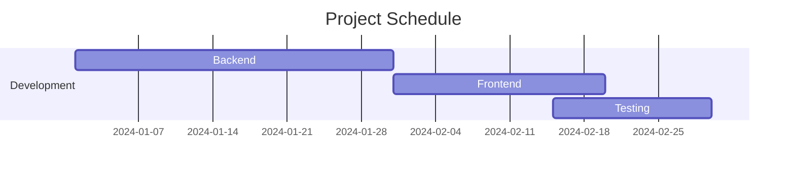
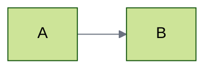
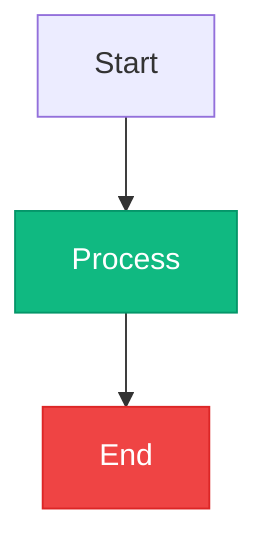

# Mermaid Diagrams
Create professional software diagrams with Mermaid's text‑based syntax. Store the `.mmd` source alongside code so diagrams stay version‑controlled and easy to update.

## When to Use
- Documenting a new feature or system design
- Explaining API request/response flows
- Visualising database schemas or entity relationships
- Mapping user journeys, business processes, or algorithms
- Describing architecture at any C4 level (context, container, component, code)
- Modelling state machines, project timelines, or data charts
- Onboarding teammates or presenting to stakeholders

## Workflow
### 1. Choose Diagram Type
| Requirement | Diagram Type |
|------------|--------------|
| Decision flow, algorithm, user journey | Flowchart |
| API or component interaction | Sequence Diagram |
| Database tables and keys | ER Diagram |
| Object‑oriented design | Class Diagram |
| System architecture overview | C4 Context / Container / Component |
| State machine or lifecycle | State Diagram |
| Project schedule | Gantt Chart |
| Data distribution | Pie / Bar Chart |
| Version control branching | Git Graph |
Select the type that matches the information you need to convey. Validate that the choice fits the audience and the diagram’s complexity.

### 2. Write the Mermaid Code
1. Start with the diagram keyword (e.g., `flowchart TD`).
2. Add comments with `%%` for clarification.
3. Use indentation for readability; it is optional.
4. End the file with a newline.

#### Core Syntax Template
```mermaid
<diagramType>
<definition lines>
```
Replace `<diagramType>` with one of the types listed above.

### 3. Validate the Diagram
- Open the code in the Mermaid Live Editor (https://mermaid.live) or a supported IDE extension.
- Check for syntax errors (misspelled keywords, missing arrows, unmatched braces).
- Ensure every node, edge, and label is clear.
- Confirm that the diagram matches the intended scope.

### 4. Render or Export
- **GitHub / GitLab** – render automatically in markdown files.
- **VS Code** – install *Markdown Preview Mermaid* extension.
- **CLI** – `npm install -g @mermaid-js/mermaid-cli` then `mmdc -i diagram.mmd -o diagram.png`.
- **Docker** – `docker run --rm -v $(pwd):/data minlag/mermaid-cli -i /data/diagram.mmd -o /data/diagram.svg`.
- **Live Editor** – export PNG or SVG directly.

## Diagram Type Quick‑Start Examples
### Flowchart (Top‑Down)

### Sequence Diagram (API Flow)

### Class Diagram (Domain Model)

### ER Diagram (Database Schema)

### C4 Context Diagram

### State Diagram (Booking Lifecycle)

### Gantt Chart (Project Timeline)


## Configuration & Theming
Add a front‑matter block to set theme and layout.

Available themes: `default`, `forest`, `dark`, `neutral`, `base`.
Layout options: `layout: dagre` (default) or `layout: elk` for complex graphs.
Use `look: handDrawn` for a sketch style.

## Styling Patterns
Define reusable classes with `classDef` and apply them with `class`.

Keep colors high‑contrast and test in both light and dark themes.

## Common Pitfalls & How to Avoid Them
- **Invalid characters** – Do not place `{}` inside comments. Escape special symbols if needed.
- **Misspelled keywords** – Mermaid fails silently; always validate in the live editor.
- **Over‑crowded diagrams** – Limit to ~20 nodes. Split large diagrams into multiple focused views.
- **Missing relationships** – Verify that every entity or component has at least one incoming or outgoing edge.
- **Incorrect cardinality in ERDs** – Use the correct symbols (`||`, `o|`, `}o`, `}|`).
- **Inconsistent flow direction** – Choose a single direction (`TD`, `LR`, etc.) and apply it consistently.

## Checklist
- [ ] Diagram type matches the information to convey
- [ ] All participants, entities, or nodes are named clearly
- [ ] Arrows show correct direction and message type (sync vs async)
- [ ] Decision nodes use `{}` and have both true/false branches
- [ ] Primary/foreign keys are marked in ER diagrams
- [ ] Theme and colors meet accessibility contrast standards
- [ ] Diagram renders without errors in the target platform
- [ ] Source file is stored in version control alongside related code
- [ ] Documentation includes a short title and purpose note
- [ ] Diagram is updated when the underlying system changes

## Sub-skills

Read a sub-skill file only when the task needs it.

| File | Use when |
|------|----------|
| [references/c4-architecture.md](references/c4-architecture.md) | Generates C4‑model architecture documentation using Mermaid diagrams. Use when you need system context, container, component, deployment, or dynamic diagrams to visualize and document software structure for stakeholders such as executives, developers, or DevOps teams. |

## Related skills

Load these when the task spans more than this skill.

- [`documentation-writing`](../documentation-writing/SKILL.md) — documentation-writing: Provides ready-to-use documentation templates and a step-by-step co-authoring workflow…
- [`software-architecture`](../software-architecture/SKILL.md) — Provides a unified workflow for making software architecture decisions, selecting patterns (Clean, Hexagonal,…
- [`database-design`](../database-design/SKILL.md) — Expert database architect for data layer design, technology selection, and schema modeling. Use for selecting…
- [`diagrams`](../diagrams/SKILL.md) — Skill for creating, editing, converting, and reviewing diagram files. Handles draw.io .drawio XML editing and…
- [`marp-slides`](../marp-slides/SKILL.md) — Creates professional Marp presentation slides. Use when a user asks for a Marp file, wants a slide deck, or re…
- [`scientific-schematics`](../scientific-schematics/SKILL.md) — Create publication-quality scientific diagrams with Nano Banana Pro AI and Gemini 3 Pro quality review. Use fo…
- [`obsidian`](../obsidian/SKILL.md) — Create, edit, and validate Obsidian Flavored Markdown, .base files, .canvas JSON files, and Web Clipper templa…
