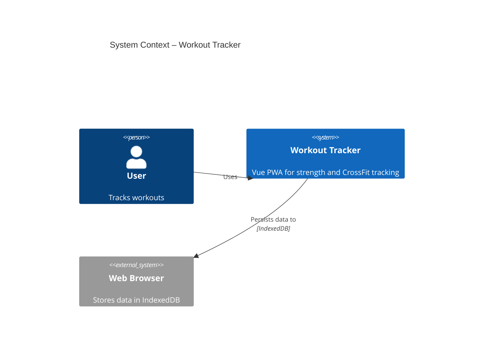
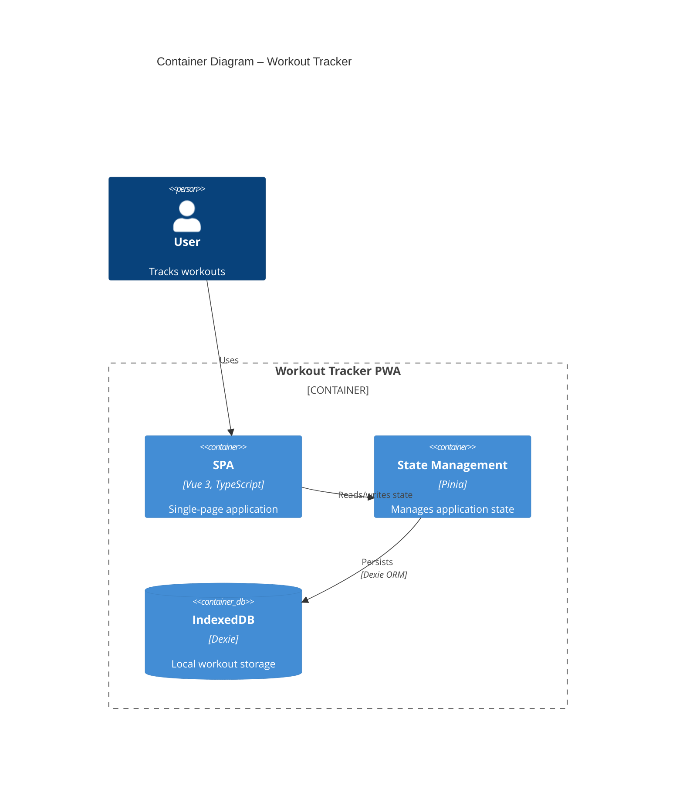
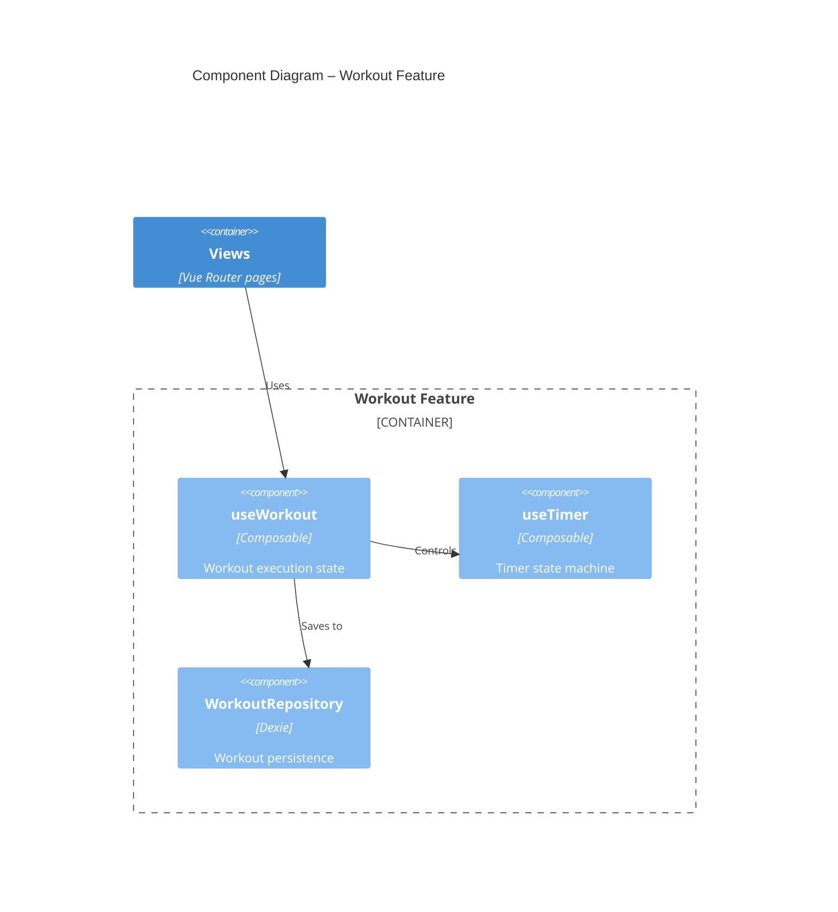
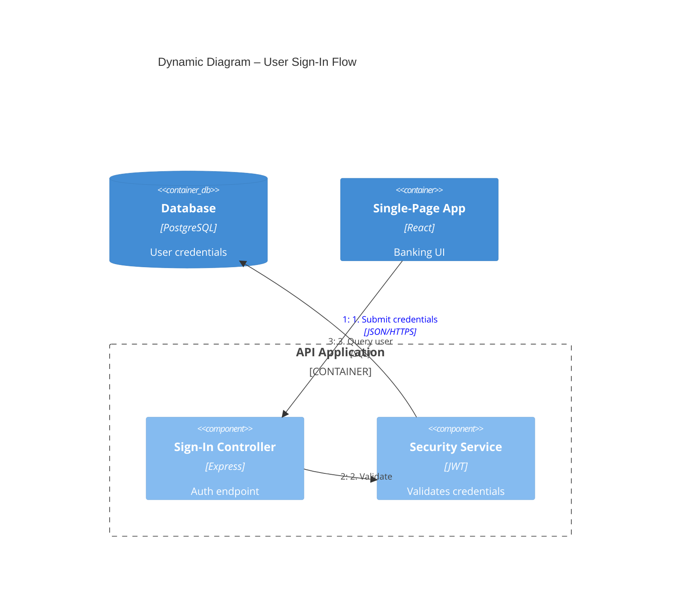
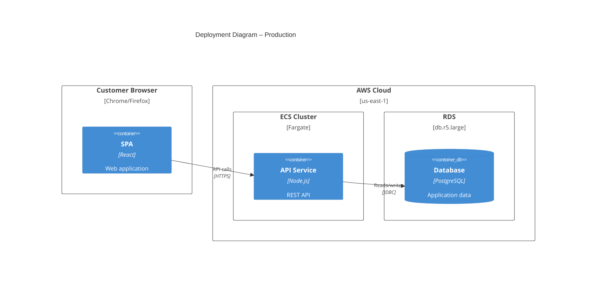
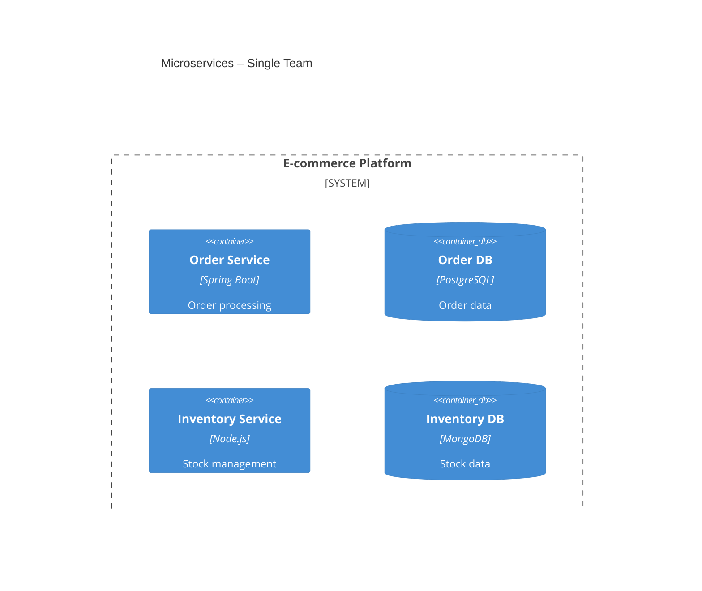
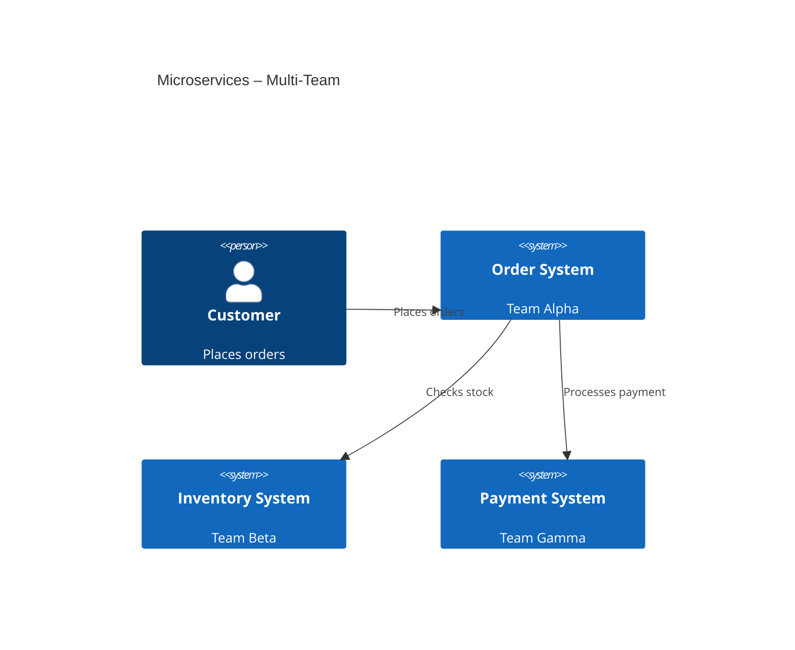
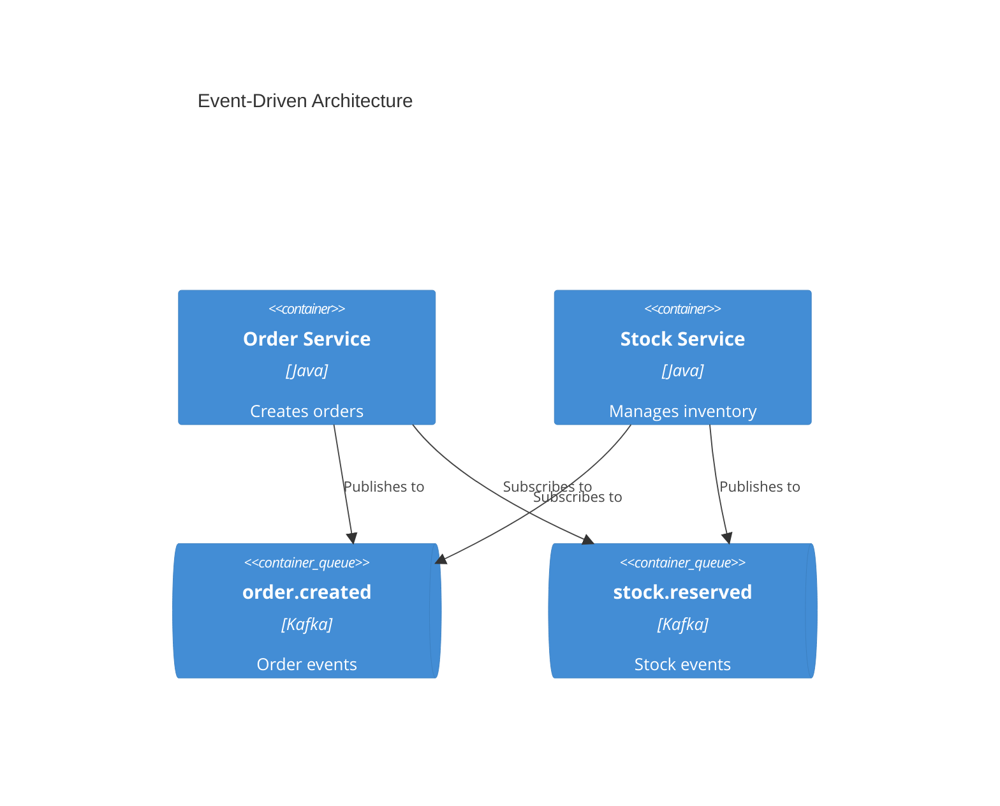

# C4 Architecture Documentation
Generate software architecture documentation with C4‑model diagrams written in Mermaid syntax.

## When to Use
- You must show the system’s scope, its containers, internal components, or deployment topology.
- Stakeholders need a visual overview: executives (high‑level), developers (detailed), or DevOps (infrastructure).
- You are asked for a "C4 diagram", "system context", "container diagram", "component diagram", "deployment diagram", or a request‑flow diagram.

## Workflow
1. **Identify audience** – decide which C4 level(s) are required.
2. **Explore the codebase** – list systems, containers, components, databases, queues, and external actors.
3. **Select diagram level(s)** – choose Context, Container, Component, Deployment, or Dynamic.
4. **Write Mermaid code** – follow the element syntax and styling rules.
5. **Save** – place each diagram in its own markdown file under `docs/architecture/`.

## C4 Diagram Levels
| Level | Diagram | Primary Audience | Shows | Typical Use |
|------|---------|------------------|-------|--------------|
| 1 | **C4Context** | Everyone | System and external actors | Always – defines scope |
| 2 | **C4Container** | Technical | Deployable containers, databases, services | Always – core technical view |
| 3 | **C4Component** | Developers | Internal components inside a container | When component detail adds value |
| 4 | **C4Deployment** | DevOps | Physical nodes, cloud services, runtime environment | For production or staging environments |
| – | **C4Dynamic** | Technical | Ordered request/response flow | For complex workflows |

> **Key Insight** – Context + Container diagrams satisfy most teams. Add Component or Deployment diagrams only when they clarify the design.

## Quick‑Start Examples
### System Context (Level 1)


### Container Diagram (Level 2)


### Component Diagram (Level 3)


### Dynamic Diagram (Request Flow)


### Deployment Diagram (Level 4)


## Element Syntax
### People & Systems
```
Person(alias, "Label", "Description")
Person_Ext(alias, "Label", "Description")
System(alias, "Label", "Description")
System_Ext(alias, "Label", "Description")
SystemDb(alias, "Label", "Description")
SystemQueue(alias, "Label", "Description")
```
### Containers
```
Container(alias, "Label", "Technology", "Description")
Container_Ext(alias, "Label", "Technology", "Description")
ContainerDb(alias, "Label", "Technology", "Description")
ContainerQueue(alias, "Label", "Technology", "Description")
```
### Components
```
Component(alias, "Label", "Technology", "Description")
Component_Ext(alias, "Label", "Technology", "Description")
ComponentDb(alias, "Label", "Technology", "Description")
```
### Boundaries
```
Enterprise_Boundary(alias, "Label") { ... }
System_Boundary(alias, "Label") { ... }
Container_Boundary(alias, "Label") { ... }
Boundary(alias, "Label", "type") { ... }
```
### Relationships
```
Rel(from, to, "Label")
Rel(from, to, "Label", "Technology")
BiRel(from, to, "Label")   # Use sparingly
Rel_U(from, to, "Label")   # Upward arrow
Rel_D(from, to, "Label")   # Downward arrow
Rel_L(from, to, "Label")   # Leftward arrow
Rel_R(from, to, "Label")   # Rightward arrow
```
### Deployment Nodes
```
Deployment_Node(alias, "Label", "Type", "Description") { ... }
Node(alias, "Label", "Type", "Description")   # Shorthand
```

## Styling & Layout
- **Layout configuration** – control shapes per row:
  ```mermaid
  UpdateLayoutConfig($c4ShapeInRow="3", $c4BoundaryInRow="1")
  ```
- **Element styling** – change colors per element:
  ```mermaid
  UpdateElementStyle(alias, $fontColor="red", $bgColor="grey", $borderColor="red")
  ```
- **Relationship styling** – adjust label position and colors:
  ```mermaid
  UpdateRelStyle(from, to, $textColor="blue", $lineColor="blue", $offsetX="5", $offsetY="-10")
  ```
Use offsets to avoid overlapping labels.

## Best Practices
- **Mandatory fields** – every element must have a name, type, technology (if applicable), and a short description.
- **Unidirectional arrows** – prefer `Rel` over `BiRel` to keep flow clear.
- **Verb‑rich labels** – e.g., `"Sends email via SMTP"` not just `"uses"`.
- **Show technology** on relationships (e.g., `"JSON/HTTPS"`).
- **Limit diagram size** – keep under 20 elements; split larger systems into multiple diagrams.
- **Start with Level 1** – always create a Context diagram first.
- **One diagram per file** – each markdown file should contain a single diagram.
- **Descriptive aliases** – use meaningful identifiers (`orderService` instead of `s1`).
- **Concise descriptions** – aim for ≤ 50 characters.
- **Always add a title** – `title System Context – <System Name>`.

### Common Pitfalls to Avoid
- Mixing containers (deployable) with components (non‑deployable).
- Modeling shared libraries as containers.
- Representing a message broker as a single container; instead model each topic/queue.
- Introducing undefined abstraction levels such as “subcomponents”.
- Omitting technology labels to “simplify” the diagram.

## Microservices Guidelines
### Single‑Team Ownership
Model each microservice as a **container** (or a container group):

### Multi‑Team Ownership
Promote each microservice to a **system** when separate teams own them:

### Event‑Driven Architecture
Show each topic or queue as a **container**, not a single “Kafka” box:


## Output Location & Naming
Store documentation under `docs/architecture/` using these conventions:
- `c4-context.md` – System Context diagram
- `c4-containers.md` – Container diagram
- `c4-components-<feature>.md` – Component diagrams per feature
- `c4-deployment.md` – Deployment diagram
- `c4-dynamic-<flow>.md` – Dynamic/request‑flow diagrams

## Audience‑Appropriate Detail
| Audience | Recommended Diagrams |
|----------|----------------------|
| Executives | Context only |
| Product Managers | Context + Container |
| Architects | Context + Container + key Components |
| Developers | All levels as needed |
| DevOps | Container + Deployment |

## Checklist
- [ ] Identify audience and required C4 level(s).
- [ ] List all actors, systems, containers, components, databases, queues.
- [ ] Choose meaningful aliases and write concise descriptions.
- [ ] Create Mermaid diagram with a clear title.
- [ ] Use `Rel` with verb‑rich labels and technology tags.
- [ ] Keep each diagram ≤ 20 elements; split if larger.
- [ ] Apply styling to improve readability (layout, colors, offsets).
- [ ] Save file to `docs/architecture/` with the proper naming convention.
- [ ] Review for common pitfalls (mis‑typed elements, missing technology, bidirectional arrows).
