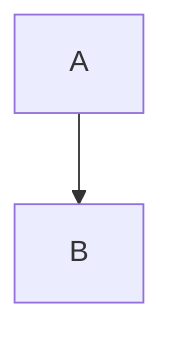

# Obsidian Skill

Create and edit content for Obsidian vaults. The skill covers Obsidian Flavored Markdown, Bases (`.base` files), JSON Canvas (`.canvas` files), and Web Clipper JSON templates. Use it to produce syntactically correct files that Obsidian can render without errors.

## When to use
- You need to write or modify a Markdown note that uses Obsidian‑specific syntax (wikilinks, callouts, embeds, frontmatter, tags, etc.).
- You are defining a Base to generate table, card, list, or map views of notes.
- You are building or updating a JSON Canvas file for mind‑maps, flowcharts, or project boards.
- You want to create a JSON template for the Obsidian Web Clipper.

---

## 1. Obsidian Flavored Markdown
### Basic formatting
- Paragraph: blank line separates paragraphs.
- Line break inside a paragraph: two trailing spaces or `Shift+Enter`.
- Headings: `#` to `######`.
- Text styles:
  - Bold: `**text**` or `__text__`
  - Italic: `*text*` or `_text_`
  - Bold + Italic: `***text***`
  - Strikethrough: `~~text~~`
  - Highlight: `==text==`
  - Inline code: `` `code` ``
- Escape special characters with a backslash, e.g. `\*not italic\*`.

### Wikilinks and block links
```markdown
[[Note Name]]                     # link to note
[[Note Name|Display Text]]        # custom label
[[Note Name#Heading]]              # link to heading
[[Note Name#^block-id]]            # link to block
[[#Heading in same note]]
[[##Search all headings]]
[[^^block search]]
```
Define a block ID by appending `^block-id` to a paragraph or on a separate line after a quote or list.

### Markdown‑style links
```markdown
[Display](Note%20Name.md)
[Display](Note%20Name.md#Heading)
[External](https://example.com)
[Obsidian link](obsidian://open?vault=VaultName&file=Note.md)
```
Spaces must be URL‑encoded as `%20`.

### Embeds
```markdown
![[Note Name]]                     # embed note
![[image.png]]                     # embed image
![[image.png|640x480]]             # width × height
![[audio.mp3]]
![[document.pdf#page=3]]
![[Note#^list-id]]                 # embed list defined with a block ID
```
External images use standard Markdown syntax.

### Callouts
```markdown
> [!note] This is a note.
> [!info] Custom Title
> [!tip] Title only
> [!faq]- Collapsed by default
> > [!question] Nested callout
```
Supported types: `note, abstract, info, todo, tip, success, question, warning, failure, danger, bug, example, quote`.

### Lists
- Unordered: `-`, `*`, or `+`.
- Ordered: `1.` or `1)`.
- Task list: `- [ ]` (incomplete) and `- [x]` (complete).

### Quotes, Code, Tables, Math, Diagrams
```markdown
> Blockquote

`inline code`
```
```javascript
// code block with language
```
| A | B |
|---|---|
| 1 | 2 |

$e^{i\pi}+1=0$   # inline LaTeX
$$
\frac{a}{b}
$$                # block LaTeX



### Footnotes and Comments
```markdown
Sentence with footnote[^1].
[^1]: Footnote text.

This is visible %%but this is hidden%% text.
%%
Hidden block comment.
%%
```

### Tags and Frontmatter
```yaml
---
title: My Note
date: 2024-01-15
tags: [project, important]
aliases: [Alt Name]
---
```
Tag syntax: `#tag`, `#nested/tag`, `#tag-with-dashes`, `#tag_with_underscores`.

### HTML snippets
```html
<div class="custom">HTML inside note</div>
<details><summary>More</summary>Hidden</details>
<kbd>Ctrl</kbd> + <kbd>C</kbd>
```
---

## 2. Obsidian Bases (`.base` files)
Bases are YAML files that define dynamic views of notes.

### Core sections
```yaml
filters:               # global filter (string or object)
  and:
    - 'file.hasTag("project")'
    - 'status != "done"'

formulas:              # reusable calculations
  days_until_due: "if(due, ((date(due) - today()) / 86400000).round(0), '')"

properties:            # display names for properties
  status:
    displayName: Status
  formula.days_until_due:
    displayName: "Days Until Due"

summaries:            # default summary formulas
  price: Sum

views:                # one or more view definitions
  - type: table
    name: "Active Tasks"
    order:
      - file.name
      - status
      - formula.days_until_due
    groupBy:
      property: status
    summaries:
      formula.days_until_due: Average
```

### Filter syntax
- Single string: `filters: 'status == "done"'`
- Logical objects: `and`, `or`, `not` with arrays of strings or nested objects.
- Operators: `==, !=, >, <, >=, <=, &&, ||, !`.

### Property types
- **Note properties** – from frontmatter, e.g. `author`.
- **File properties** – metadata such as `file.name`, `file.mtime`, `file.tags`.
- **Formula properties** – defined in `formulas` section, referenced as `formula.myFormula`.

### Formula language (selected functions)
| Category | Example |
|----------|---------|
| Date | `now()`, `today()`, `date("2024-01-01")` |
| Math | `if(price > 0, price * quantity, 0)` |
| String | `string.lower()`, `string.replace(" ", "_")` |
| List | `list.filter(value > 10)`, `list.unique()` |
| File | `file.hasTag("book")`, `file.inFolder("Notes")` |
| Global | `if(condition, trueResult, falseResult)` |

### View types
- **Table** – columns defined in `order`.
- **Cards** – visual cards, useful for images.
- **List** – simple list view.
- **Map** – requires latitude/longitude properties and the Maps plugin.

### Common patterns
```yaml
# Filter by tag
filters:
  and:
    - file.hasTag("project")

# Filter by folder
filters:
  and:
    - file.inFolder("Reading")

# Date range (last 7 days)
filters:
  and:
    - 'file.mtime > now() - "7d"'
```

### Embedding a Base in a note
```markdown
![[MyBase.base]]               # embed default view
![[MyBase.base#View Name]]      # embed specific view
```

### YAML quoting rules
- Use single quotes when the value contains double quotes.
- Use double quotes for simple strings.
- Escape inner quotes appropriately.

---

## 3. JSON Canvas (`.canvas` files)
Canvas files store infinite‑canvas data as JSON.

### File skeleton
```json
{
  "nodes": [],
  "edges": []
}
```

### Node definition (common fields)
| Field | Required | Type | Description |
|-------|----------|------|-------------|
| `id` | Yes | string | 16‑character hex ID (e.g., `6f0ad84f44ce9c17`) |
| `type` | Yes | string | `text`, `file`, `link`, or `group` |
| `x` | Yes | integer | Horizontal position (pixels) |
| `y` | Yes | integer | Vertical position (pixels) |
| `width` | Yes | integer | Node width |
| `height` | Yes | integer | Node height |
| `color` | No | string | Preset (`"1"`‑`"6"`) or hex `"#RRGGBB"` |

#### Specific node types
- **Text** – requires `text` field with Markdown content.
- **File** – requires `file` path; optional `subpath` (`#Heading` or `^block`).
- **Link** – requires `url`.
- **Group** – optional `label`, `background`, `backgroundStyle` (`cover`, `ratio`, `repeat`).

### Edge definition
```json
{
  "id": "edge-id",
  "fromNode": "source-id",
  "toNode": "target-id",
  "fromSide": "right",
  "toSide": "left",
  "fromEnd": "none",
  "toEnd": "arrow",
  "color": "3",
  "label": "leads to"
}
```
- `fromSide` / `toSide`: `top`, `right`, `bottom`, `left`.
- `fromEnd` / `toEnd`: `none` or `arrow`.
- `color` follows the same preset or hex rules as nodes.

### Layout guidelines
- Coordinates may be negative; canvas is infinite.
- Recommended node sizes:
  - Small text: 200‑300 × 80‑150 px
  - Medium text: 300‑450 × 150‑300 px
  - Large text: 400‑600 × 300‑500 px
  - File preview: 300‑500 × 200‑400 px
- Keep 20‑50 px padding inside groups and 50‑100 px between nodes.
- Align to a 10‑ or 20‑pixel grid for a tidy layout.

### Validation rules
1. All `id` values are unique across nodes and edges.
2. `fromNode` and `toNode` reference existing node IDs.
3. Required fields for each node type must be present.
4. `type` must be one of the four allowed values.
5. `backgroundStyle` (if present) must be `cover`, `ratio`, or `repeat`.
6. Side values and end shapes must be from the allowed lists.
7. Colors must be a preset (`"1"`‑`"6"`) or a valid hex string.

---

## 4. Obsidian Web Clipper Templates (JSON)
Templates define how the Web Clipper extracts data from a web page.

### Workflow
1. **Identify intent** – know the site or content type (e.g., YouTube video, recipe).
2. **Locate a matching Base** – read `Templates/Bases/*.base` to reuse property names.
3. **Fetch a sample URL** – use `WebFetch` to retrieve HTML.
4. **Analyze the page** – look for Schema.org JSON, meta tags, or CSS selectors that provide the needed data.
5. **Draft the JSON** – follow the schema below.
6. **Verify variables** – ensure each variable (`preset`, `schema`, `selector`) exists in the analysis.

### Minimal JSON structure
```json
{
  "schemaVersion": "0.1.0",
  "name": "My Template",
  "description": "Clips articles from Example.com",
  "variables": {
    "title": { "selector": "meta[property='og:title']", "type": "text" },
    "author": { "selector": "meta[name='author']", "type": "text" },
    "date": { "selector": "meta[property='article:published_time']", "type": "date" }
  },
  "filters": {
    "date": "date.format('YYYY-MM-DD')"
  },
  "properties": {
    "title": "{{title}}",
    "author": "{{author}}",
    "date": "{{date}}"
  }
}
```
- `variables` map a name to a selector or preset.
- `filters` apply formatting functions (e.g., `date.format('YYYY-MM-DD')`).
- `properties` define the final note frontmatter keys.

### Available variables & filters
- **Presets**: `url`, `title`, `excerpt`, `author`, `date`, `image`.
- **Filters**: `date.format()`, `string.lower()`, `string.replace()`, `number.round()`, `html.strip()`.
- Combine filters with the pipe syntax: `{{date|date.format('YYYY-MM-DD')}}`.

---

## Checklist
- **Markdown**: use correct heading level, escape characters when needed, verify frontmatter YAML is valid.
- **Wikilinks**: ensure target note exists; use `#` for headings and `^` for block IDs.
- **Callouts**: choose a supported type; add custom CSS only if a stylesheet is present.
- **Bases**:
  - Validate YAML syntax.
  - Test global and view‑specific filters.
  - Confirm formulas compile and return expected types.
  - Verify view `type` and `order` fields reference existing properties.
- **Canvas**:
  - Generate unique 16‑character hex IDs.
  - Check required fields for each node type.
  - Ensure edges reference existing node IDs.
  - Confirm colors use allowed presets or hex values.
- **Web Clipper Template**:
  - Run the template on a sample URL.
  - Verify each variable selector returns data.
  - Apply filters and confirm final note frontmatter matches the intended schema.

## Related skills

Load these when the task spans more than this skill.

- [`documentation-writing`](../documentation-writing/SKILL.md) — documentation-writing: Provides ready-to-use documentation templates and a step-by-step co-authoring workflow…
- [`mermaid-diagrams`](../mermaid-diagrams/SKILL.md) — Generates Mermaid diagram code for flowcharts, sequence diagrams, class diagrams, ERDs, C4 architecture, state…
- [`notion`](../notion/SKILL.md) — Creates structured Notion pages from conversations, decisions, how‑tos, FAQs, or research findings. Use when y…
- [`file-organization`](../file-organization/SKILL.md) — Organizes files and folders intelligently: analyzes directory structure, finds duplicates, proposes logical fo…
- [`scientific-writing`](../scientific-writing/SKILL.md) — Write and revise scientific manuscripts in full paragraphs using IMRAD or conference structure, verified citat…
- [`notebooklm`](../notebooklm/SKILL.md) — NotebookLM skill lets you authenticate, manage, and query Google NotebookLM notebooks from Claude Code, run st…
