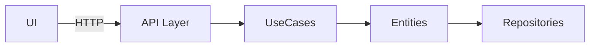

# Software Architecture Skill

**Purpose** – Guide architects and developers through a disciplined process for designing, evaluating, and documenting software architectures. The skill covers requirement analysis, trade‑off evaluation, pattern selection, domain‑driven design (DDD) considerations, code‑style rules, and a validation checklist.

---

## When to Use
- Designing a new backend or full‑stack system.
- Refactoring a monolith into a modular or micro‑service architecture.
- Establishing architecture standards for a team or organization.
- Evaluating technology or pattern choices for scalability, testability, or maintainability.
- Planning DDD, CQRS, event‑sourcing, or saga‑based workflows.

---

## 1. Architectural Decision Framework
1. **Gather Requirements** – List functional goals, non‑functional constraints (performance, security, compliance), and business priorities.
2. **Identify Constraints** – Regulatory limits, existing infrastructure, team expertise, budget, and timeline.
3. **Generate Alternatives** – For each major concern (e.g., data access, service boundaries, UI integration) list viable patterns or technologies.
4. **Trade‑off Analysis** – Use a simple table:
   | Alternative | Pros | Cons | Risk | Effort |
   |-------------|------|------|------|-------|
   | Clean Architecture | Clear separation, testable | More layers, learning curve | Low | Medium |
   | Hexagonal | Infrastructure‑agnostic | May need adapters for each external system | Low | Medium |
   | Monolith (simple) | Fast to implement | Hard to scale later | Medium | Low |
5. **Decision Record** – Write an Architecture Decision Record (ADR) for each significant choice. Include context, considered options, chosen option, rationale, and consequences.
6. **Validate** – Ensure the chosen design satisfies all high‑priority requirements and that the team has the skills to implement it.

---

## 2. Architecture Patterns Overview
| Pattern | When to Choose | Core Characteristics |
|---------|----------------|-----------------------|
| **Clean Architecture** | Complex business rules, need for testability | Layers: Entities → Use Cases → Interface Adapters → Frameworks. Dependencies point inward only. |
| **Hexagonal (Ports & Adapters)** | Want infrastructure‑agnostic core, multiple UI or DB options | Core domain surrounded by ports (interfaces) and adapters (implementations). |
| **Domain‑Driven Design (DDD)** | Rich domain with evolving rules, multiple teams, need for ubiquitous language | Bounded contexts, aggregates, domain events, strategic subdomains. |
| **CQRS** | High read/write disparity, need for separate scaling of queries and commands | Separate command model (writes) and query model (reads). |
| **Event Sourcing** | Auditability, replayability, complex state transitions | Store state as immutable events; rebuild current state by replaying. |
| **Saga / Orchestration** | Long‑running, multi‑service transactions | Coordinated sequence of local transactions with compensation actions. |
| **Microservices** | Independent deployability, team autonomy, varied scaling needs | Each service owns its data and API; communicate via contracts (REST/GraphQL/Message). |

**Selection Process**
1. Map domain complexity (use DDD viability checklist – see section 3).
2. Determine scalability and deployment requirements.
3. Choose the simplest pattern that meets the constraints.
4. Document the choice in an ADR.

---

## 3. Domain‑Driven Design (DDD) Guidance
### Viability Check (use before committing to full DDD)
Adopt full DDD if **at least two** of the following are true:
- Business rules are complex, frequently changing, or require explicit invariants.
- Multiple teams work on overlapping domains, causing model collisions.
- Integration contracts are unstable or need versioning.
- Auditing, traceability, or regulatory compliance is critical.

### Strategic Modeling Steps
1. **Identify Subdomains** – Core, Supporting, Generic.
2. **Define Bounded Contexts** – Clear ownership boundaries; avoid leaking concepts.
3. **Create Ubiquitous Language Glossary** – Terms used by domain experts and developers.
4. **Document Context Maps** – Show relationships (Customer‑Supplier, Conformist, Anticorruption Layer).

### Tactical Patterns (when DDD is adopted)
- **Entities** – Identity‑based objects with lifecycle.
- **Value Objects** – Immutable, no identity.
- **Aggregates** – Cluster of entities with a root enforcing invariants.
- **Domain Events** – Capture state changes for eventual consistency.
- **Repositories** – Abstract persistence, return aggregates.
- **Factories** – Encapsulate complex creation logic.

### Integration with Other Patterns
- Use **CQRS** for read‑heavy contexts.
- Pair **Event Sourcing** with aggregates for audit trails.
- Apply **Saga** orchestration for cross‑context transactions.

---

## 4. Code‑Style and Quality Rules
### General Principles
- **Early Return** – Prefer guard clauses over deep nesting.
- **Single Responsibility** – Each module, class, or function should have one clear purpose.
- **Limit Size** – Functions ≤ 50 lines, files ≤ 200 lines. Split larger units.
- **Prefer Arrow Functions** (JavaScript/TypeScript) when readability improves.

### Library‑First Approach
1. Search npm, Maven, PyPI, or other registries before writing custom code.
2. Evaluate SaaS or third‑party APIs for common concerns (auth, retries, caching).
3. Use well‑maintained libraries (e.g., `cockatiel` for retries, `zod` for validation).
4. Write custom code only when:
   - Business logic is unique.
   - Performance constraints cannot be met by existing libs.
   - Security requires full control.
   - No suitable library exists after thorough evaluation.

### Naming Conventions
- **Avoid** generic names: `utils`, `helpers`, `common`.
- **Use** domain‑specific names: `OrderCalculator`, `UserAuthenticator`, `InvoiceGenerator`.
- Follow bounded‑context prefixes when appropriate (e.g., `Billing/InvoiceService`).

### Separation of Concerns
- Keep UI code free of business logic.
- Controllers should delegate to use‑case or service classes.
- Data access lives in repository or data‑mapper layers, not in controllers.
- Infrastructure (DB, messaging, external APIs) is accessed through interfaces defined in the domain layer.

### Error Handling & Testing
- Use typed catch blocks (TypeScript) or specific exception classes.
- Return error objects or throw domain‑specific exceptions.
- Write unit tests for each use case and integration tests for adapters.
- Keep test files alongside the code they test (`src/.../order.service.test.ts`).

---

## 5. Validation Checklist (Before Finalizing Architecture)
- [ ] Requirements are fully captured and prioritized.
- [ ] Constraints (regulatory, budget, team skill) are listed.
- [ ] All major decisions have a documented ADR with trade‑off analysis.
- [ ] Simpler alternatives were evaluated and rejected with justification.
- [ ] Chosen pattern matches domain complexity and scalability goals.
- [ ] Bounded contexts and module boundaries are clearly defined.
- [ ] Naming follows domain‑specific conventions.
- [ ] Code‑style rules (size limits, early returns, separation) are enforced.
- [ ] Third‑party libraries have been vetted for security and licensing.
- [ ] Performance metrics and monitoring points are identified.
- [ ] Security controls (input validation, auth, parameterized queries) are planned.
- [ ] Migration path from existing system (if any) is outlined.

---

## 6. Common Commands & Tooling (No external scripts required)
```bash
# Install dependencies (Node.js example)
npm install
# Install Python dependencies
pip install -r requirements.txt

# Run static analysis / linting
npm run lint
# Run unit tests
npm test

# Generate an ADR template (manual example)
cat <<EOF > docs/adr/001-use-clean-architecture.md
# ADR 001 – Use Clean Architecture
Date: $(date +%Y-%m-%d)
## Context
...
## Decision
...
## Consequences
...
EOF

# Visualize architecture (use Mermaid in markdown)

```
---

## 7. Pitfalls & Anti‑Patterns to Avoid
- **NIH Syndrome** – Reinventing authentication, state management, or validation when mature solutions exist.
- **Mixing Concerns** – Business logic inside UI components or controllers.
- **Generic Modules** – `utils.js` that becomes a dumping ground for unrelated functions.
- **Over‑Engineering** – Applying full DDD or microservices to a simple CRUD app.
- **Deep Nesting** – More than three levels of conditional logic.
- **Large Files/Functions** – Hard to read, test, and maintain.
- **Missing ADRs** – Decisions made without documentation lead to knowledge loss.

---

## 8. References & Further Reading
- *Clean Architecture* by Robert C. Martin.
- *Domain‑Driven Design* by Eric Evans.
- *Patterns of Enterprise Application Architecture* by Martin Fowler.
- ADR template: https://github.com/joelparkerhenderson/architecture-decision-record
- Mermaid diagram syntax: https://mermaid.js.org/

---

**End of Skill**

## Related skills

Load these when the task spans more than this skill.

- [`clean-code`](../clean-code/SKILL.md) — Pragmatic clean code standards for AI-assisted development. Covers naming, function design, code structure, an…
- [`code-review`](../code-review/SKILL.md) — Review code changes for correctness, security, performance, maintainability, tests, and production readiness.…
- [`cloud-architecture`](../cloud-architecture/SKILL.md) — Provides step‑by‑step guidance, best‑practice rules, and checklists for designing, building, and optimizing se…
- [`database-design`](../database-design/SKILL.md) — Expert database architect for data layer design, technology selection, and schema modeling. Use for selecting…
- [`backend-development`](../backend-development/SKILL.md) — Guidance for designing, building, and operating scalable backend services and APIs. Covers REST GraphQL gRPC A…
- [`mermaid-diagrams`](../mermaid-diagrams/SKILL.md) — Generates Mermaid diagram code for flowcharts, sequence diagrams, class diagrams, ERDs, C4 architecture, state…
- [`diagrams`](../diagrams/SKILL.md) — Skill for creating, editing, converting, and reviewing diagram files. Handles draw.io .drawio XML editing and…
