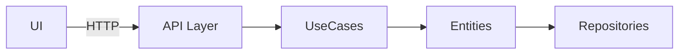

# Patterns, DDD, Structure, and Validation

Parent: [`software-architecture`](../SKILL.md). Generic code style: [`clean-code`](../../clean-code/SKILL.md).

## Decision framework

1. Gather requirements: functional goals, non-functional constraints (performance, security, compliance), business priorities.
2. List constraints: regulation, existing infrastructure, team skills, budget, timeline.
3. Generate alternatives per major concern (data access, service boundaries, UI integration).
4. Compare in a trade-off table:

| Alternative | Pros | Cons | Risk | Effort |
|---|---|---|---|---|
| Clean Architecture | Clear separation, testable | More layers, learning curve | Low | Medium |
| Hexagonal | Infrastructure-agnostic | Adapter per external system | Low | Medium |
| Monolith (simple) | Fast to build | Hard to scale later | Medium | Low |

5. Record each significant choice as an ADR ([architecture-decision-records.md](architecture-decision-records.md)).
6. Validate: design meets all high-priority requirements; team can build it.

## Pattern characteristics

| Pattern | Core characteristics |
|---|---|
| Clean Architecture | Entities -> Use Cases -> Interface Adapters -> Frameworks; dependencies point inward only |
| Hexagonal | Core domain surrounded by ports (interfaces) and adapters (implementations) |
| DDD | Bounded contexts, aggregates, domain events, strategic subdomains |
| CQRS | Separate command (write) and query (read) models |
| Event Sourcing | State stored as immutable events; current state rebuilt by replay |
| Saga / Orchestration | Sequence of local transactions with compensation actions |
| Microservices | Each service owns its data and API; contracts via REST, GraphQL, or messages |

## DDD

**Strategic steps**
1. Identify subdomains: Core, Supporting, Generic.
2. Define bounded contexts with clear ownership; do not leak concepts.
3. Keep a ubiquitous-language glossary (see [`documentation`](../../documentation/SKILL.md) context-and-decisions).
4. Draw context maps: Customer-Supplier, Conformist, Anticorruption Layer.

**Tactical patterns**
- Entity: identity-based, has lifecycle.
- Value Object: immutable, no identity.
- Aggregate: entity cluster; root enforces invariants.
- Domain Event: records a state change for eventual consistency.
- Repository: abstracts persistence, returns aggregates.
- Factory: holds complex creation logic.

**Combine**: CQRS for read-heavy contexts; Event Sourcing + aggregates for audit trails; Saga for cross-context transactions.

## Structure rules

- Size limits: functions <= 50 lines, files <= 200 lines; split larger units. Max 3 nesting levels.
- Names: no `utils`, `helpers`, `common`. Use domain names (`OrderCalculator`, `InvoiceGenerator`), bounded-context prefixes (`Billing/InvoiceService`).
- Separation: no business logic in UI; controllers delegate to use cases; data access in repositories or data mappers; infrastructure behind interfaces owned by the domain layer.
- Errors: specific exception classes or typed error objects; domain-specific exceptions.
- Tests: unit test per use case, integration test per adapter, test file next to source (`src/.../order.service.test.ts`).
- Library first: search npm, Maven, PyPI, and SaaS APIs (auth, retries, caching) before custom code, e.g. `cockatiel` (retries), `zod` (validation). Write custom code only for unique business logic, unmet performance needs, security that needs full control, or no suitable library.

## Diagram

## Anti-patterns

| Anti-pattern | Fix |
|---|---|
| NIH: custom auth, state, validation | Use a mature library |
| Business logic in UI or controllers | Move to use cases |
| `utils.js` dumping ground | Domain-named modules |
| Full DDD or microservices for simple CRUD | Simplest pattern that fits |
| Large files, deep nesting | Split; guard clauses |
| Decisions without ADRs | Write an ADR |

## Validation checklist

- [ ] Requirements captured and prioritized; constraints listed.
- [ ] Every major decision has an ADR with trade-offs; simpler options rejected with reasons.
- [ ] Pattern matches domain complexity and scale goals.
- [ ] Bounded contexts and module boundaries defined.
- [ ] Domain naming and structure rules enforced.
- [ ] Third-party libraries vetted for security and license.
- [ ] Performance metrics and monitoring points named.
- [ ] Security controls planned (input validation, auth, parameterized queries).
- [ ] Migration path from the current system outlined.

## Further reading

- *Clean Architecture*, Robert C. Martin. *Domain-Driven Design*, Eric Evans. *Patterns of Enterprise Application Architecture*, Martin Fowler.
- ADR templates: https://github.com/joelparkerhenderson/architecture-decision-record
- Mermaid: https://mermaid.js.org/
